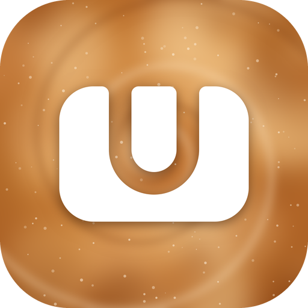

<p align="center">
  
</p>

<h1 align="center">EspressU</h1>

<p align="center">
  A Wii U emulator for iPad and iPhone, built on <a href="https://github.com/cemu-project/Cemu">Cemu</a>.
  Based on <a href="https://github.com/MuffinEMU/Muffin-EMU">MuffinEMU</a> by Void.
</p>

<p align="center">
  
  
  
  
  <a href="LICENSE.txt"></a>
  
</p>

---

- Metal renderer with a persistent shader cache
- ARM64 recompiler (JIT), built in, iOS 17.4 and later
- Controller support (DualSense, Xbox, MFi) and an on-screen GamePad
- Games as `.wua` files, decrypted folders, or encrypted with your own `keys.txt`; updates and DLC can be imported

EspressU contains no firmware, keys or games. You need your own dumps from your own Wii U.

## Install

You need an iPad or iPhone on iOS 17.4 or later with Developer Mode turned on.

1. Download the unsigned `EspressU.ipa` from the [Releases](https://github.com/EspressU/EspressU-Emu/releases) page.
2. Install it with [SideInstaller](https://github.com/FrizzleM/SideInstaller).
3. In SideInstaller, turn on the built-in memory limit increase for EspressU. Without a higher limit, most games run out of memory.
4. Open EspressU, go to Settings › JIT, import your pairing file and connect LocalDevVPN. JIT starts on its own when you launch a game. Without JIT the much slower interpreter runs.
5. Add your games from the library with the Add button.

## Build

You need a Mac with Xcode. Once:

```sh
brew install cmake ninja xcodegen pkg-config autoconf automake libtool
xcodebuild -downloadComponent MetalToolchain
```

Then:

```sh
git clone --recursive https://github.com/EspressU/EspressU-Emu.git
cd EspressU-Emu
ci/build-stikjit.sh
cmake -S . -B build-ios -G Ninja \
  -DCMAKE_SYSTEM_NAME=iOS -DCMAKE_OSX_SYSROOT=iphoneos -DCMAKE_OSX_ARCHITECTURES=arm64 \
  -DCMAKE_OSX_DEPLOYMENT_TARGET=15.0 -DVCPKG_TARGET_TRIPLET=arm64-ios \
  -DBUILD_HEADLESS_DYLIB=ON -DCMAKE_MACOSX_BUNDLE=OFF -DCMAKE_BUILD_TYPE=Release
cmake --build build-ios --target CemuBin
mkdir -p build-ios/out && rm -rf build-ios/out/Cemu.framework && cp -R build-ios/src/Cemu.framework build-ios/out/
cd src/ios && xcodegen generate
xcodebuild -project EspressU.xcodeproj -scheme EspressU -sdk iphoneos -configuration Release CODE_SIGNING_ALLOWED=NO build
```

The result is an unsigned `EspressU.app`. Zip it into a `Payload` folder as an `.ipa` and sign it with your own certificate. It needs the entitlements `get-task-allow`, `com.apple.developer.kernel.increased-memory-limit` and `com.apple.developer.kernel.extended-virtual-addressing`.

## License

[MPL-2.0](LICENSE.txt). EspressU is built on Cemu; the copyright notices in the source files stay in place. Libraries and their licenses are listed in [docs/docs/licenses.html](docs/docs/licenses.html) and in the app under Settings › About.

Wii U is a trademark of Nintendo. EspressU is not affiliated with Nintendo.
