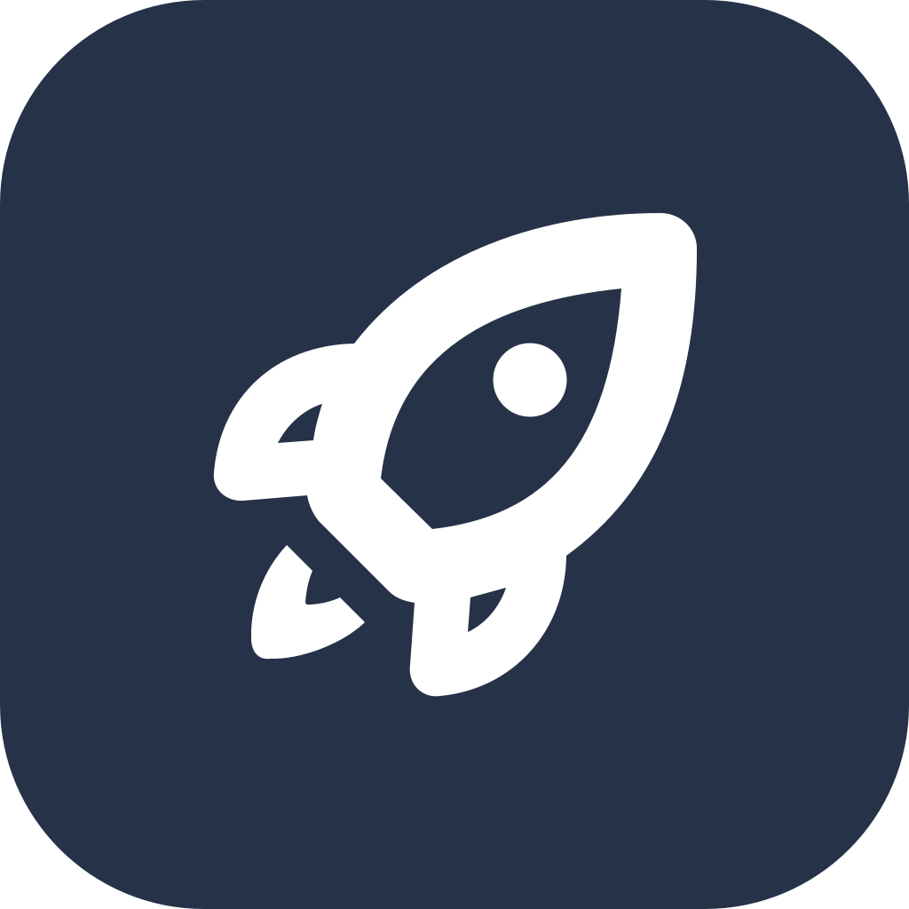

<p align="center">
  
</p>

<h1 align="center">EspressU</h1>

<p align="center">
  <b>A free, open-source Wii U emulator for iPhone and iPad.</b><br>
  Built on <a href="https://github.com/cemu-project/Cemu">Cemu</a> with a Metal renderer, built-in JIT and frame generation.
</p>

<p align="center">
  
  
  
  
  <a href="LICENSE.txt"></a>
  
</p>

<p align="center">
  <a href="https://flekstore.com/espressu">Download on FlekStore</a> ·
  <a href="https://github.com/EspressU/EspressU-Emu/releases">Releases</a> ·
  <a href="https://discord.gg/HPRJGXTEt8">Discord</a>
</p>

---

## Contents

- [Features](#features)
- [Requirements](#requirements)
- [Installation](#installation)
- [Setting up JIT](#setting-up-jit)
- [Adding games](#adding-games)
- [Troubleshooting](#troubleshooting)
- [Building from source](#building-from-source)
- [Contributing](#contributing)
- [License](#license)
- [Credits](#credits)

## Features

- **Metal renderer.** Graphics run on Apple's Metal. A persistent shader cache means fewer shaders to compile the next time you play.
- **Frame generation.** Smoother gameplay on top of the emulated frame rate.
- **Built-in JIT.** An ARM64 recompiler for iOS 17.4 and later. Without JIT only the much slower interpreter runs.
- **Controllers.** DualSense, Xbox and MFi controllers, or an on-screen GamePad you can lay out yourself.
- **Game formats.** `.wua`, `.wux`, `.wud` and `.rpx` files, plus decrypted folders.
- **Updates and DLC.** Import updates and DLC for your games as `.wua` files.

> [!NOTE]
> EspressU contains no firmware, keys or games. You need your own dumps from your own Wii U.

## Requirements

- iPhone or iPad on iOS or iPadOS **17.4 or later**
- **Developer Mode** turned on
- Your own game dumps

## Installation

1. **Get the app.** Download the unsigned `EspressU.ipa` from the [Releases](https://github.com/EspressU/EspressU-Emu/releases) page.
2. **Sign and install the IPA.** Use [SideInstaller](https://sideinstaller.net/). It signs the app on your device, so you do not need a computer.
3. **Raise the memory limit.** In SideInstaller, turn on the built-in memory limit increase for EspressU. Without it most games run out of memory.

## Setting up JIT

1. Open EspressU and go to **Settings › JIT**.
2. Import your pairing file, or generate one directly on your device.
3. Connect **LocalDevVPN**.

After that JIT starts on its own whenever you launch a game.

## Adding games

Tap the **Add** button in the library and choose a game.

- **`.wua`** is a single file and needs no keys.
- **`.wux` and `.wud`** are encrypted dumps and need your own `keys.txt`.
- **`.rpx`** files and **decrypted folders** work as they are.

EspressU can also decrypt a game on your device into a `.wua` file or a folder.

## Troubleshooting

- **A game closes on its own.** It most likely ran out of memory. Install with SideInstaller and turn on the memory limit increase.
- **A game is very slow.** JIT is probably off. Check that LocalDevVPN is connected and a pairing file is set up.
- **A game will not open.** Encrypted dumps (`.wud`, `.wux`) need your own `keys.txt`. `.wua` files and decrypted folders do not.

Still stuck? Ask on the [Discord](https://discord.gg/HPRJGXTEt8).

## Building from source

You need a Mac with Xcode. Run this once:

```sh
brew install cmake ninja xcodegen pkg-config autoconf automake libtool
xcodebuild -downloadComponent MetalToolchain
```

Then build:

```sh
git clone --recursive https://github.com/EspressU/EspressU-Emu.git
cd EspressU-Emu
ci/build-stikjit.sh
cmake -S . -B build-ios -G Ninja \
  -DCMAKE_SYSTEM_NAME=iOS -DCMAKE_OSX_SYSROOT=iphoneos -DCMAKE_OSX_ARCHITECTURES=arm64 \
  -DCMAKE_OSX_DEPLOYMENT_TARGET=17.4 -DVCPKG_TARGET_TRIPLET=arm64-ios \
  -DBUILD_HEADLESS_DYLIB=ON -DCMAKE_MACOSX_BUNDLE=OFF -DCMAKE_BUILD_TYPE=Release
cmake --build build-ios --target CemuBin
mkdir -p build-ios/out && rm -rf build-ios/out/Cemu.framework && cp -R build-ios/src/Cemu.framework build-ios/out/
cd src/ios && xcodegen generate
xcodebuild -project EspressU.xcodeproj -scheme EspressU -sdk iphoneos -configuration Release CODE_SIGNING_ALLOWED=NO build
```

The result is an unsigned `EspressU.app`. Zip it into a `Payload` folder as an `.ipa` and sign it with your own certificate. It needs these entitlements:

- `get-task-allow`
- `com.apple.developer.kernel.increased-memory-limit`
- `com.apple.developer.kernel.extended-virtual-addressing`

## Contributing

Pull requests are welcome. Please read [CONTRIBUTING.md](CONTRIBUTING.md) first.

## License

EspressU is licensed under the [MPL-2.0](LICENSE.txt). Two parts of the project have their own terms:

| Part | Licence | Terms |
| --- | --- | --- |
| Files written by EspressU (the licence is stated in each file's header) | [EspressU Licence](LICENSES/EspressU-Licence.txt) | Non-commercial use only, fully open source, keep the notice, credit "EspressU (https://espressu.dev)" |
| On-screen touch controls ([Crema](src/ios/App/Crema)) | [Crema Licence](src/ios/App/Crema/LICENSE.txt) | Non-commercial use only, fully open source, prominent credit |

Everything else, including Muffin and third-party files, stays under its original licence. The copyright notices in the source files must stay in place. Libraries and their licenses are listed in [docs/docs/licenses.html](docs/docs/licenses.html) and in the app under Settings › About.

## Credits

EspressU is built on [Cemu](https://github.com/cemu-project/Cemu) and was originally based on [MuffinEMU](https://github.com/MuffinEMU/Muffin-EMU).

Wii U is a trademark of Nintendo. EspressU is not affiliated with Nintendo.
